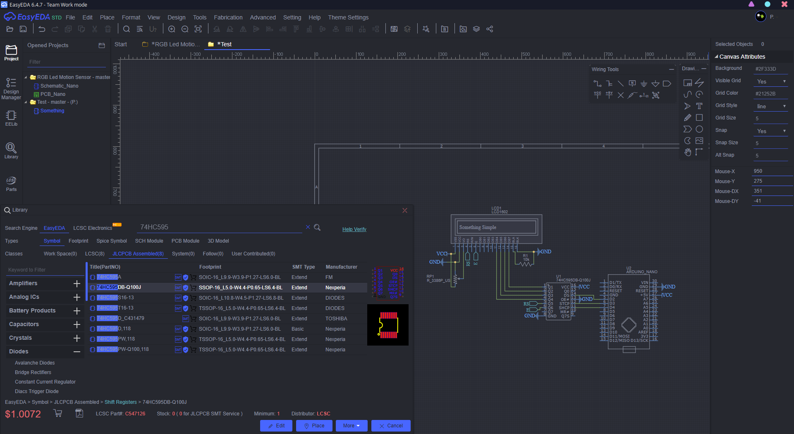
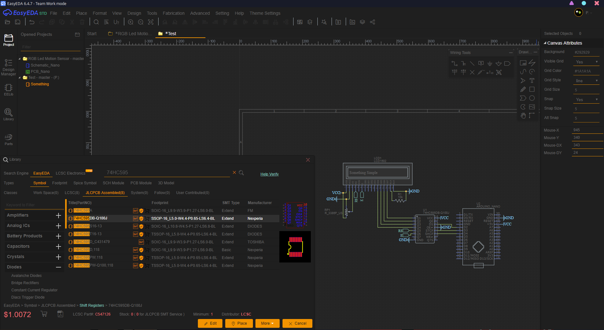
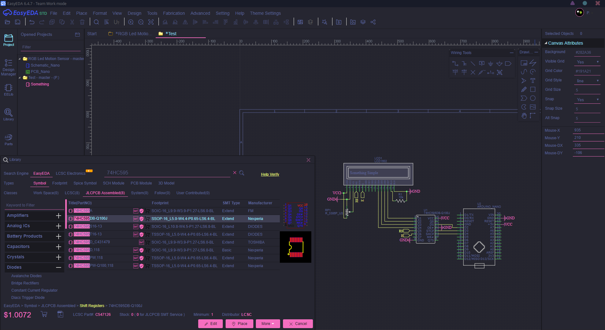
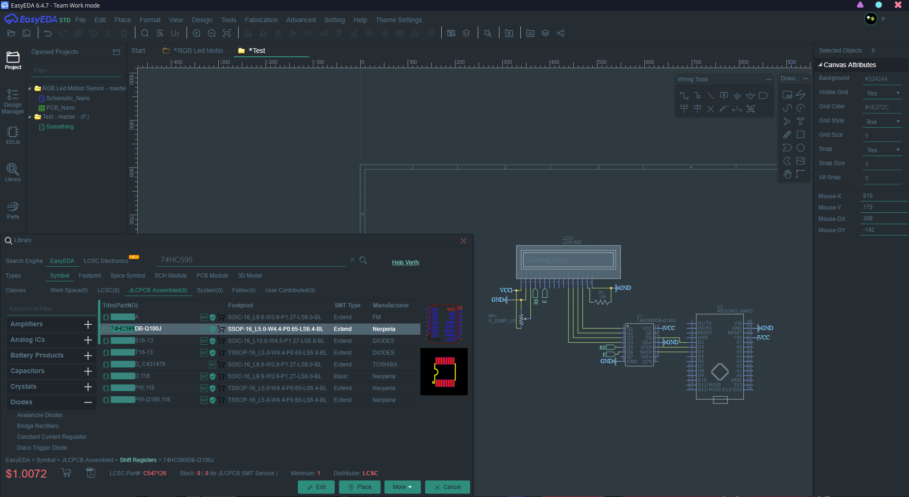

  
  

# EasyEDA Themes Extension

## Overview

This extension revamps the entire EasyEDA UI with 19 unique **Dark** 🕶️ and some **Light** themes.

Supports separate App and Schematic themes. Works in any browser or the standalone app.

**Note:** This extension only works with the standard edition of EasyEDA, not the Pro edition.

## 💾 Installing 

1) Download the latest [release](https://github.com/FiercestT/EasyEdaThemes/releases/).
2) Now in EasyEDA, open the extensions window by going to: `Advanced > Extensions > Extensions Settings`.
3) Select `Load Extension > Select Files`.
4) Select **all** of the files from the `extension` folder from the downloaded repository.
5) **Make sure** that the `Extension ID` field says `themes`. Then load the extension.
6) Thats it! The themes extension is now mounted.
7) You can now go to `Themes > Select Theme` to select a theme.

Note: If you are having issues or remount the extension, refresh the page (`Right Click > Reload` on standalone app).

## 📷 Screenshots

One Dark

Darker

Dracula

Oceanic

## 🔨 Contributing

Whether you want to add to the project, edit it for yourself, or fix some CSS that I missed, the following can help you out a bit when it comes to the project and EasyEDA extensions.

### File Structure

| File         | Description                                                            |
|--------------|-----------------------------------------------------------------------|
| main.js      | The main code for the extension.                                       |
| manifest.json | Must be present to identify the extension.                             |
| style.txt    | CSS styling. It is a .txt since extensions don't allow .css uploads.    |
| themes.json  | Theme definitions with `app` and `schematic` color palettes.            |
| locale.txt   | Translations.                                                          |

### Adding Themes

Themes are defined in `themes.json` with two sections per theme:
- `app` - UI colors (background, text, buttons, accent, etc.)
- `schematic` - Schematic editor colors (wire, bus, junction, pin, etc.)

### CSS Development

Extensions can only mount js, jpg, png, gif, svg, txt, json, and md files, so the stylesheet is uploaded as .txt. To make CSS editing easier, use `Themes > Edit CSS` to update CSS without remounting.

### API

EasyEDA can load uploaded resources using an API call. These are loaded as blobs and must be processed. EasyEDA has some basic documentation and outdated examples for their API. You can use developer tools and prettify main.min.js to explore what API calls are possible.
